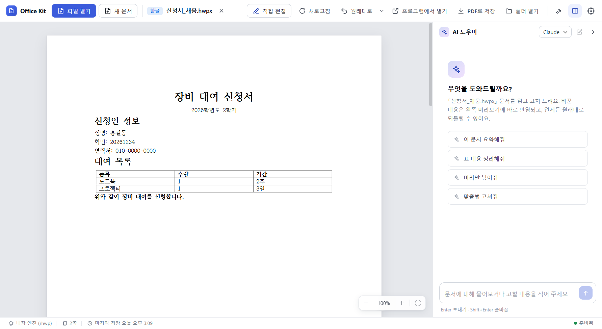
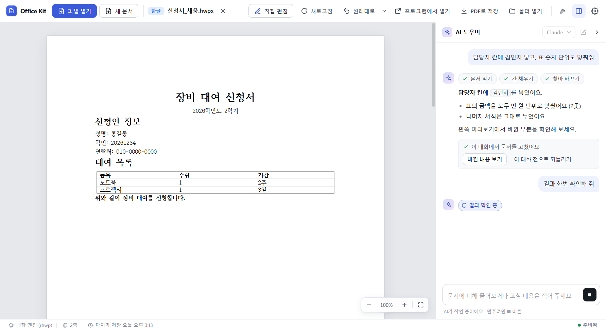
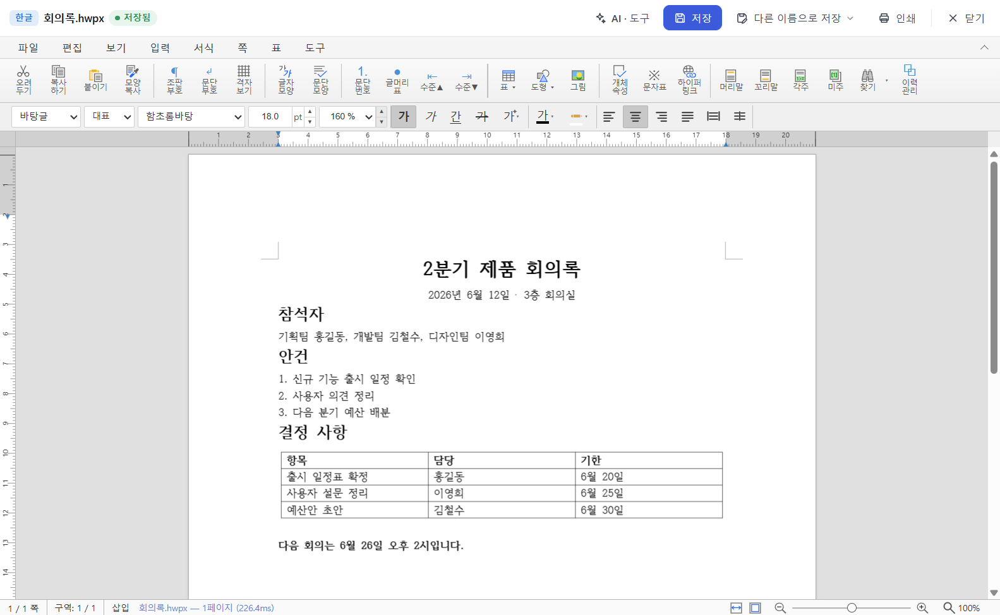
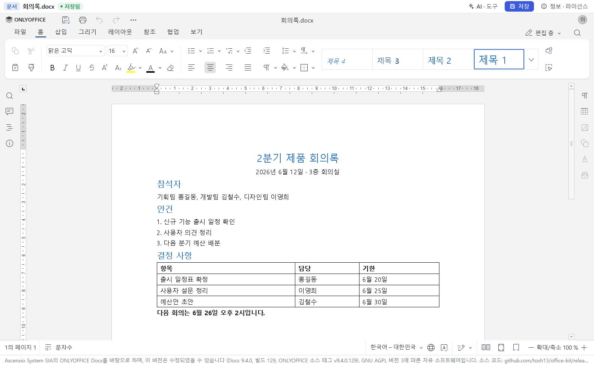
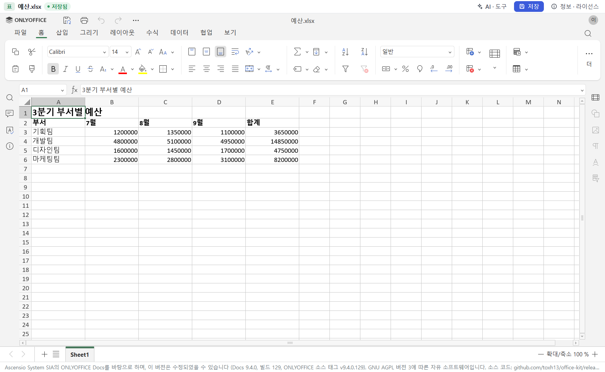
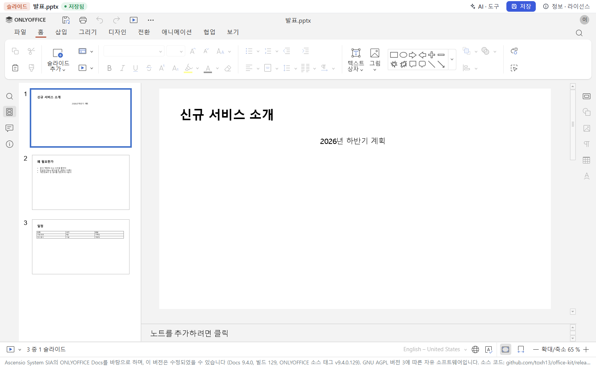
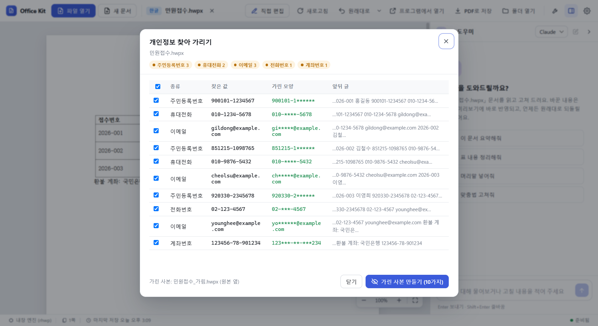
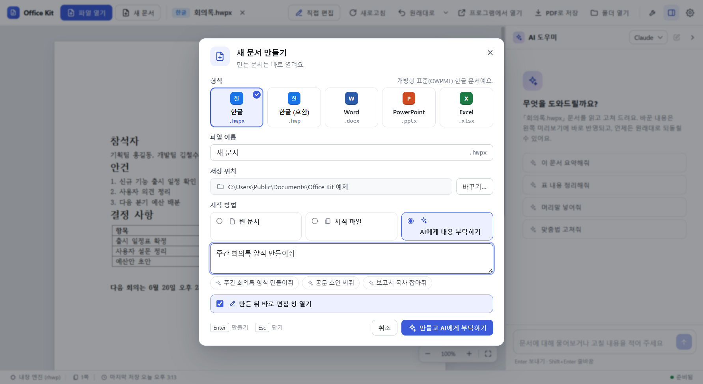
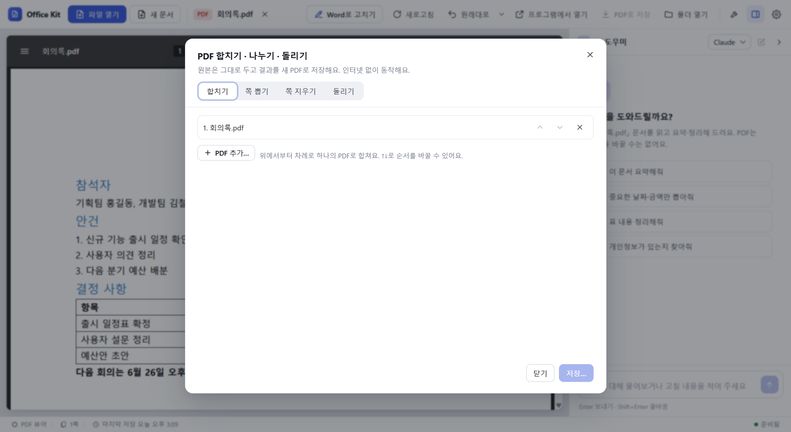

<p align="center"></p>

# Office Kit

A Windows desktop app to **open, check and edit** Hangul (HWP/HWPX), Word, PowerPoint and Excel documents — by hand or by talking to an AI.

[Website](https://toxh13.github.io/office-kit/) · [Download (Releases)](https://github.com/toxh13/office-kit/releases/latest) · [한국어 README](README.md)



- Reads and edits HWP/HWPX, docx, pptx and xlsx **without** Hancom Office or Microsoft Office (built-in engines and editors).
- If those programs **are** installed, Office Kit uses them for exact previews and PDF export.
- Hangul documents can be saved as **PDF** even without Hancom Office.
- The AI uses the **Claude Code** or **Codex** CLI that you installed and signed in to yourself. Office Kit never handles your credentials.
- UI languages: Korean, English, Japanese (Settings → Preview · display → Language; follows Windows by default).

## Requirements

| Item | Details |
|---|---|
| OS | **Windows 10/11 (x64)** |
| AI features (optional) | [Claude Code](https://code.claude.com/docs) or [Codex CLI](https://github.com/openai/codex), installed and signed in by you. Viewing, editing and converting work without them |
| Exact preview / PDF (optional) | Installed Word, Excel, PowerPoint or Hancom Office. Otherwise the built-in engines are used |

## Install

1. Download **`OfficeKit-Setup-<version>.exe`** from [GitHub Releases](https://github.com/toxh13/office-kit/releases/latest).
2. Run it. It installs for the current user only, no admin rights needed (`%LOCALAPPDATA%\Programs\Office Kit`).
3. If "Windows protected your PC" appears, click **More info → Run anyway**. The installer is not code-signed.

The installer adds shortcuts, an **"Open with Office Kit"** context-menu entry and registers Office Kit as a *candidate* default app (you choose whether to make it the default). Uninstall from Settings → Apps. There is no auto-update; install a newer release over the old one.

## Features

**Preview and AI chat** — drop a document on the window; ask the AI things like "Fill the 담당자 field with Hong Gildong". Changes show up in the preview right away, with **View changes** and **Undo this chat**.


*The conversation in this picture is an example for illustration.*

**Edit Hangul documents in the app** (Ctrl+E) — offline, no Hancom Office needed. Saved in the original format.



**Edit Word, Excel and PowerPoint files in the app** — built-in editor (see License for its origin), offline, no Microsoft Office needed.

| Document (docx) | Spreadsheet (xlsx) | Slides (pptx) |
|---|---|---|
|  |  |  |

**Find and mask personal data** — Korean resident registration numbers, phone numbers, e-mail, card, account, passport and driver's licence numbers. Creates a masked copy and leaves the original untouched. Works offline.



> Detection is pattern-based and **can miss things** (text inside images, numbers with unusual spacing or formats). Always open the masked copy and check it before sharing.

**New documents** — blank, from templates, or "ask the AI to write it".



**PDF tools** — view PDFs, ask the AI about them, merge, extract or delete pages, rotate. Offline; the original is kept.



## Data notice

- **When you use the AI features, document contents are sent to Anthropic (Claude Code) or OpenAI (Codex) under your own account**, and are handled under their terms and privacy policies.
- Without the AI, documents stay on your PC. Office Kit has no server of its own and sends no telemetry.
- Network access happens only when you ask for it: downloading the Hancom automation security module (from Hancom's official GitHub), or opening a link in your default browser.

## Use it from Claude Desktop, Claude Code or Codex (MCP)

In the app: Settings → **Connections** → turn on the target, then restart that program. Or from a terminal:

```powershell
office-kit setup claude-desktop
office-kit setup claude-code
office-kit setup codex
office-kit setup codex --remove
```

Manual config (Claude Desktop):

```json
{
  "mcpServers": {
    "office-kit": {
      "command": "C:\\Users\\<you>\\AppData\\Local\\Programs\\Office Kit\\Office Kit.exe",
      "args": ["C:\\Users\\<you>\\AppData\\Local\\Programs\\Office Kit\\resources\\app\\src\\mcp\\server.mjs"],
      "env": { "ELECTRON_RUN_AS_NODE": "1" }
    }
  }
}
```

No separate Node.js is needed. The 22 tools:

| Group | Tools |
|---|---|
| Common | `office_status` `office_info` `office_read` `office_fields` `office_fill` `office_replace` `office_set_cells` `office_convert` `office_create` `office_page_image` |
| Personal data | `office_find_pii` `office_mask_pii` |
| Batch / PDF | `office_hwpx_batch` `office_pdf_tools` |
| Per format | `hwp_inspect` `hwp_edit` `word_inspect` `word_edit` `ppt_inspect` `ppt_edit` `excel_inspect` `excel_edit` |

Tool messages and the command line (`office-kit help`) are in Korean.

## Known limitations

- Windows only; installer not code-signed.
- The built-in Hangul engine/editor and the in-app Office editor are not identical to Hancom Office or Microsoft Office. Check important documents after saving.
- PDF export of docx/pptx/xlsx needs the matching Microsoft Office program.

More details (in Korean): [README.md](README.md), [docs/FEATURES.md](docs/FEATURES.md). Building from source: [docs/DEVELOPMENT.md](docs/DEVELOPMENT.md).

## License

- Office Kit's own source files: [MIT](LICENSE) © toxh13. Bundled third-party components and their licenses are listed in [THIRD-PARTY-NOTICES.txt](THIRD-PARTY-NOTICES.txt).
- **AGPL parts**: the office editor bundle (`vendor/office-editor/`, a modified ONLYOFFICE Docs Community Edition 9.4.0 with filex-office-editor) and files marked `SPDX-License-Identifier: AGPL-3.0-*` (filex patches, the font list generator) are under the **GNU AGPL v3** ([text](LICENSES/AGPL-3.0.txt), [ONLYOFFICE additional terms](LICENSES/ONLYOFFICE-additional-terms.txt)).
- Because the AGPL font list generator is loaded into the app's main process, **the installed application as a whole is distributed under the AGPL-3.0**. Its complete source is this repository at the matching release tag, plus the `office-editor-source-<version>.zip` attached to each Release. Details: [docs/LICENSES-OFFICE-EDITOR.md](docs/LICENSES-OFFICE-EDITOR.md).
- PDF.js (inside unpdf) is under the Apache License 2.0 ([text](LICENSES/Apache-2.0.txt)).
- **No warranty**: provided "as is", without warranty of any kind.

**Trademarks** — Hancom, Hangul (한글) and HWP are trademarks of Hancom Inc. Word, Excel and PowerPoint are trademarks of Microsoft and are used only to refer to file formats. ONLYOFFICE® and ONLYOFFICE Docs™ are trademarks of Ascensio System SIA. Claude is a trademark of Anthropic; Codex of OpenAI. Office Kit is not affiliated with or endorsed by any of them.
