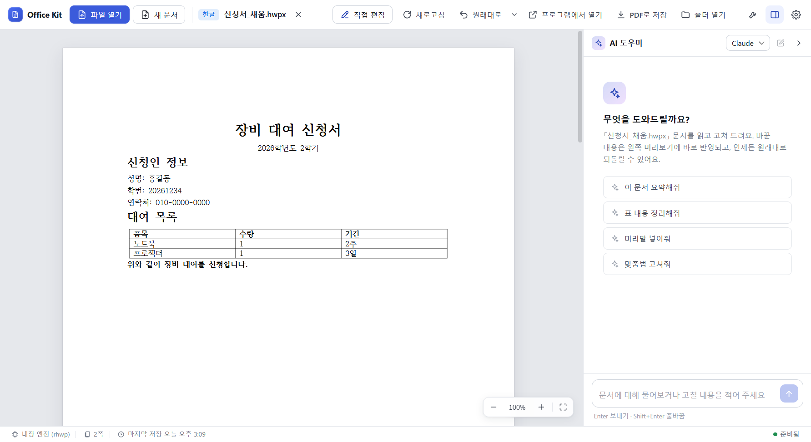
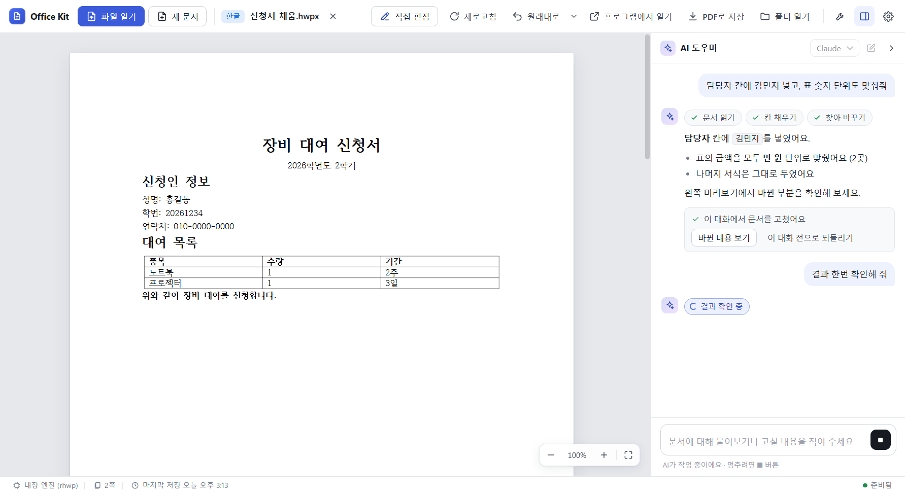
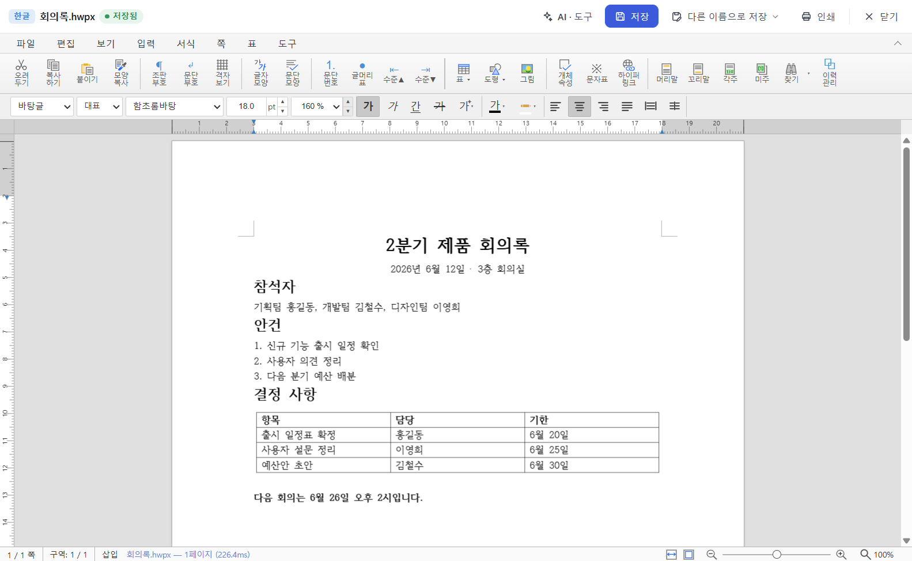
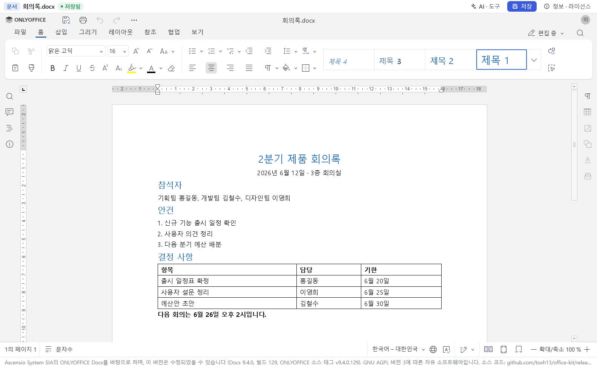
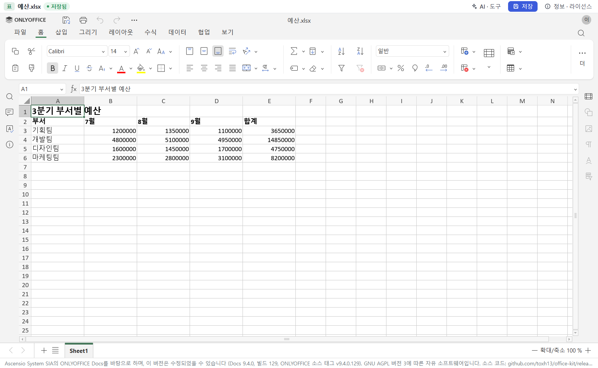
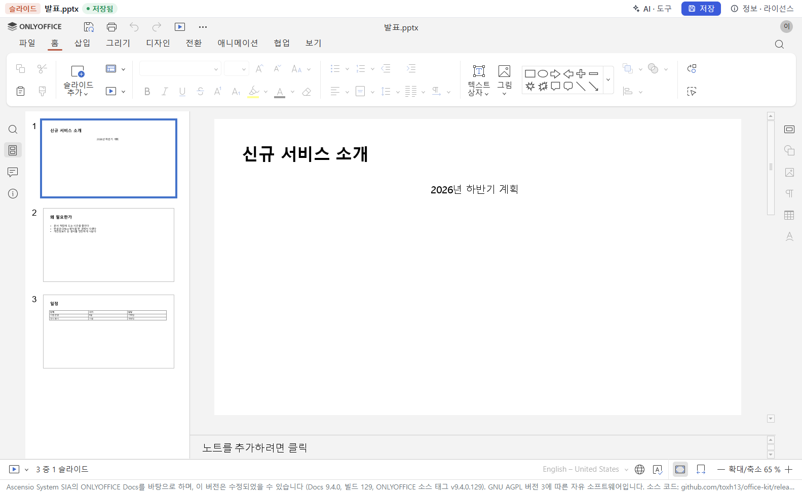
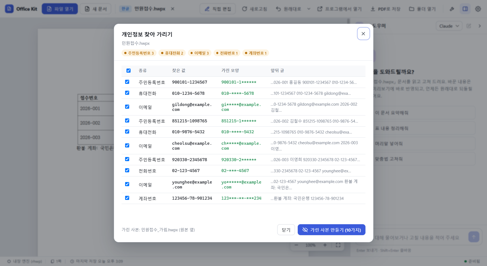
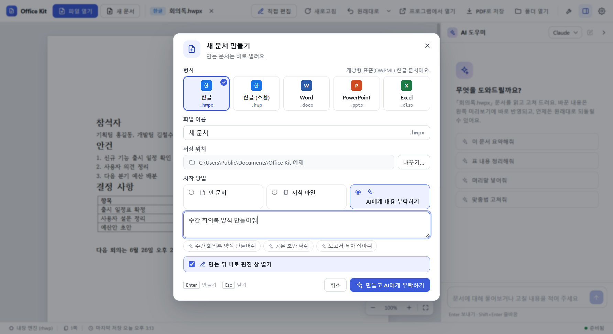
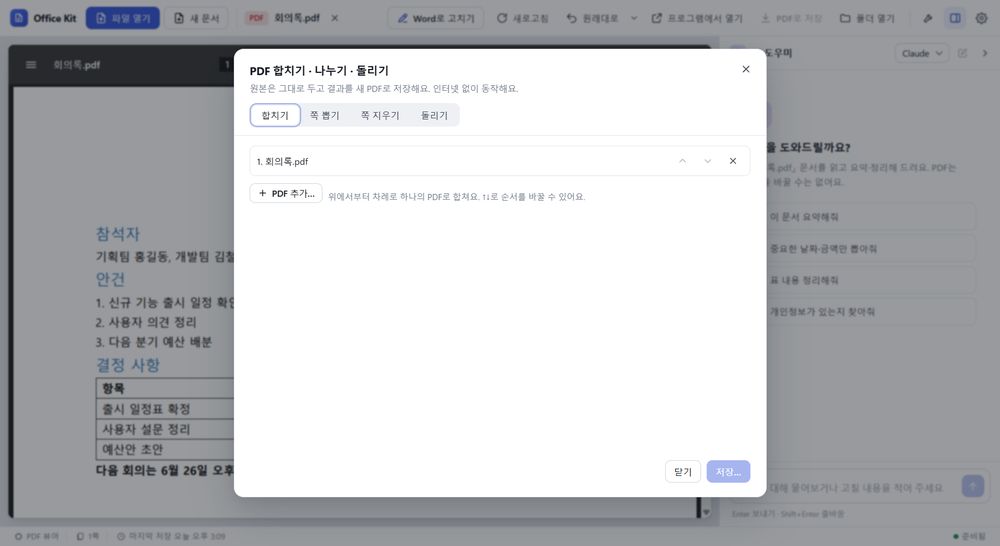
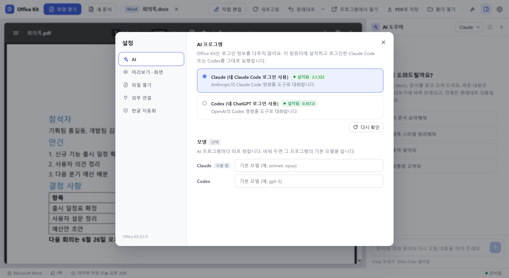

<p align="center"></p>

# Office Kit

한글(HWP·HWPX)·Word·PowerPoint·Excel 문서를 **열고, 확인하고, 직접 또는 AI 대화로 고치는** Windows 데스크톱 도구.

[안내 사이트](https://toxh13.github.io/office-kit/) · [내려받기 (Releases)](https://github.com/toxh13/office-kit/releases/latest) · [English](README.en.md)



- 한컴오피스·MS Office가 **없어도** 한글/Word/PowerPoint/Excel 파일을 읽고 고칠 수 있다 (내장 엔진·내장 편집기).
- 프로그램이 **있으면** 그 프로그램으로 원본 그대로 처리하고 PDF도 만든다.
- 한글 문서는 한컴오피스가 없어도 **PDF로 저장**된다.
- AI는 내 PC에 로그인해 둔 **Claude Code** 또는 **Codex**를 그대로 쓴다. Office Kit는 로그인 정보를 다루지 않는다.

---

## 필요한 것

| 항목 | 내용 |
|---|---|
| 운영체제 | **Windows 10/11 (x64)** |
| AI 기능 (선택) | 직접 설치·로그인한 [Claude Code](https://code.claude.com/docs) 또는 [Codex CLI](https://github.com/openai/codex). 없어도 보기·편집·변환은 된다 |
| 정확한 미리보기·PDF (선택) | 설치된 Word·Excel·PowerPoint·한컴오피스. 없으면 내장 엔진으로 처리한다 |

## 설치

1. [GitHub Releases](https://github.com/toxh13/office-kit/releases/latest)에서 **`OfficeKit-Setup-<버전>.exe`** 를 받는다.
2. 실행한다. 관리자 권한 없이 내 계정에만 설치된다 (기본 위치 `%LOCALAPPDATA%\Programs\Office Kit`).
3. "Windows의 PC 보호" 창이 뜨면 **추가 정보 → 실행**. 설치 파일에 코드 서명이 없어서 뜨는 경고다.

설치하면 생기는 것:

| 항목 | 내용 |
|---|---|
| 바로 가기 | 바탕화면 · 시작 메뉴 "Office Kit" |
| 오른쪽 클릭 메뉴 | 문서 파일에 **"Office Kit로 열기"** (기본 연결 프로그램은 그대로) |
| 기본 프로그램 후보 | Windows 설정 → 앱 → 기본 앱, 탐색기 "연결 프로그램"에 Office Kit가 나온다. 고르는 것은 사용자가 한다 |
| 대상 형식 | hwp hwpx hwt · docx doc rtf odt · pptx ppt odp · xlsx xls xlsm csv ods · pdf |

지우기: 설정 → 앱 → "Office Kit" 제거. 오른쪽 클릭 메뉴·기본 프로그램 후보·명령줄 파일도 함께 지워진다.
- 남는 것: 설정·최근 파일·문서 버전·미리보기 PDF(`%APPDATA%\office-kit`), AI 작업 폴더(`%LOCALAPPDATA%\office-kit`). 필요 없으면 직접 지운다.
- Claude Desktop·Codex에 연결해 둔 `office-kit` 항목도 남는다. 지우기 전에 설정 → 외부 연결에서 끈다.
- 자동 업데이트는 없다. 새 버전은 Releases에서 받아 덮어 설치한다.

---

## 주요 기능

### 문서 보기 · AI로 고치기

창에 끌어다 놓으면 왼쪽에 미리보기, 오른쪽에 AI 도우미가 뜬다. "담당자 칸에 홍길동 넣어줘"처럼 말하면 AI가 문서를 고치고, 미리보기에 바로 반영된다. 고친 뒤에는 **바뀐 내용 보기**와 **이 대화 전으로 되돌리기**가 뜬다.


*AI 대화 화면. 그림의 대화는 화면 설명용 예시다.*

### 한글 직접 편집

한글 문서를 열고 **직접 편집** (Ctrl+E). 앱 안 한글 편집기(rhwp-studio)가 **인터넷 없이, 한컴오피스 없이** 동작한다. 원래 형식 그대로 저장한다.



### Word · Excel · PowerPoint 직접 편집

docx·xlsx·pptx도 **직접 편집**으로 앱 안 편집 창(출처는 아래 라이선스 절)에서 고친다. **인터넷 없이, Microsoft Office 없이** 동작한다.

| 문서 (docx) | 표 (xlsx) | 슬라이드 (pptx) |
|---|---|---|
|  |  |  |

### 개인정보 찾아 가리기

주민·외국인등록번호, 휴대전화·전화번호, 이메일, 카드·계좌·여권·운전면허번호를 찾아 고른 것만 가린 사본(`<이름>_가림.<확장자>`)을 만든다. 원본은 그대로다. 인터넷·AI 없이 동작한다.



> **주의:** 글자 규칙으로 찾기 때문에 **놓칠 수 있다** (그림 속 글자, 띄어 쓴 번호, 규칙에 없는 형식 등). 남에게 보내기 전에 **가린 사본을 꼭 열어 확인**한다.

### 새 문서

**새 문서** (Ctrl+N) → 한글(.hwpx/.hwp)·Word·PowerPoint·Excel. 빈 문서, 서식 파일(회의록·기안문·이력서·예산표 등), 또는 **AI에게 내용 부탁하기**("주간 회의록 양식 만들어줘")로 시작한다.



### PDF 도구

PDF를 열어 보고, AI로 요약·질문한다. 여러 PDF 합치기, 쪽 뽑기·지우기, 돌리기를 **인터넷 없이** 한다. 원본은 그대로 두고 새 PDF로 저장한다.



---

## 사용법

### 문서 열기
- 창에 **끌어다 놓기**, `파일 열기`, 또는 탐색기에서 오른쪽 클릭 → **Office Kit로 열기**.
- 한글·docx·pptx·xlsx는 열면 **편집 창이 바로 뜬다** (설정 → 파일 열기 → "미리보기만"으로 바꿀 수 있다). 옛 형식(doc·ppt·xls 등)은 미리보기로 연다.
- **프로그램에서 열기**: 설치된 Word·Excel·PowerPoint·한컴오피스 창에서 연다.
- PDF·암호 문서처럼 편집 창으로 못 여는 문서는 주 창(미리보기)으로 연다.

### 기본 프로그램으로 정하기
- 설정 → **파일 열기** → **Windows 기본 앱 설정 열기** → 바꿀 형식(.docx·.hwp …)을 눌러 **Office Kit**를 고른다.
- 한 형식만: 탐색기에서 오른쪽 클릭 → **연결 프로그램 → 다른 앱 선택 → Office Kit → 항상**.
- 기본 프로그램이면 문서를 두 번 누를 때 **그 문서의 편집 창 하나만** 뜬다. 편집 창의 **AI · 도구**를 누르면 오른쪽에 AI 대화·버전 목록·도구 옆 창이 붙는다.

### 문서 버전 · 되돌리기
- 문서를 열 때, 편집 창에서 저장하기 전, AI 대화마다 고치기 전, 되돌리기 전에 **버전을 저절로 남긴다** (문서마다 최근 30개).
- 상단 **원래대로**: 마지막 변경 전으로. 옆 **▾** → 버전 목록에서 **이 버전으로 되돌리기**, **바뀐 내용**(글 비교. 서식·그림 변화는 나오지 않음).

### 직접 편집
- 한글: 저장 `Ctrl+S`(원래 형식 그대로), 다른 이름으로 저장 `Ctrl+Shift+S`(.hwpx/.hwp, PDF), 10분 자동 저장(복구 사본 — 원본은 그대로).
- Word·Excel·PowerPoint 형식: 저장 `Ctrl+S`(원래 형식 그대로). 자동 저장은 **원본을 덮어쓰지 않고** 복구용 사본만 만든다. 위 막대 **정보 · 라이선스**에 편집기 출처와 소스 주소가 있다.
- 글꼴은 이 PC에 설치된 것을 쓴다.
- 다른 곳(AI·다른 프로그램)에서 파일이 바뀌면 편집 창이 다시 불러오거나 **다시 불러오기 / 내 편집 유지**를 묻는다.
- 덮어쓰기 전 내용은 백업 폴더에 남는다.
- 직접 편집하지 않는 것: 암호 걸린 문서, 매크로 문서(docm·xlsm·pptm). 옛 형식(doc·xls·ppt·odt 등)은 설치된 Office가 있으면 새 형식으로 바꿔 열고 **원본 옆에 새 형식으로 따로 저장**한다.
- 편집 창은 앱 밖으로 나가는 요청을 모두 막는다. 문서 안 링크는 "기본 브라우저로 열까요?"를 물은 뒤 연다.

### AI 대화
- 오른쪽 **AI 도우미** 창에 할 일을 쓴다. `Enter` 보내기, `Shift+Enter` 줄바꿈.
- 예: "표 2행 금액 합계 넣어줘", "{{담당자}}를 홍길동으로 채워줘", "이 문서 PDF로 저장해줘".
- AI는 Office Kit 문서 도구만 쓴다 (명령 실행·웹 도구 없음). 열린 문서와 그 대화에서 만든 파일만 고친다.
- AI는 **저장된 파일**을 고친다. 편집 창에 저장 안 한 내용이 있으면 보내기 전에 묻는다.

형식별로 이런 것도 부탁할 수 있다:

| 형식 | 할 수 있는 것 | 예 | 필요한 것 |
|---|---|---|---|
| Word | 스타일·서식, 목록, 표, 그림, 머리말·꼬리말·쪽 번호, 메모, 변경 내용 추적, 목차, 각주 | "제목들을 제목 1 스타일로 정리하고 맨 앞에 목차 넣어줘" | 설치된 Word |
| PowerPoint | 슬라이드 추가·삭제·순서, 발표자 노트, 글상자·그림·표·차트, 배경, 화면 전환 | "슬라이드마다 발표자 노트 달아줘" | 설치된 PowerPoint |
| Excel | 시트, 행·열, 서식, 병합, 틀 고정, 정렬, 필터, 차트, 조건부 서식 | "1행 굵게 하고 틀 고정해줘" | Excel 우선. 없으면 내장 엔진(일부 제외) |
| 한글 | 문단 넣기·지우기, 글자·문단 서식, 표 칸·행, 머리말·꼬리말, 각주, 그림, 쪽 설정 | "표 1 맨 아래에 합계 행 추가해줘" | 없음 — 내장 엔진(rhwp) |

작업 목록·한계: [`docs/FEATURES.md`](docs/FEATURES.md).

### 도구 (상단 🔧)
- **개인정보 찾아 가리기** (위 '주요 기능').
- **PDF 합치기 · 나누기 · 돌리기**: 쪽 뽑기 예 `1-3,5`, 90·180·270° 돌리기.
- **한글 → HWPX 일괄 변환**: 파일·폴더(하위 폴더 포함)의 .hwp를 .hwpx로 바꾸고, 다시 열어 쪽 수·표 수·글이 원본과 같은지 확인한다. 결과는 CSV 보고서로 저장할 수 있다.

### 인쇄 · 서식 파일 · 최근 문서
- **인쇄**: Ctrl+P. 한글은 Windows 인쇄 대화상자, Word·Excel·PowerPoint 문서는 PDF로 만들어 PDF 앱에서 인쇄한다.
- 서식 파일의 칸은 {{이름}} 꼴(한글은 누름틀)이라 AI에게 "칸 채워줘"라고 부탁할 수 있다.
- 최근 문서는 📌로 고정할 수 있다.

### 미리보기 · PDF로 저장

| 형식 | 미리보기 | PDF로 저장 |
|---|---|---|
| 한글 | 내장 엔진(rhwp)으로 바로 그림. "정확하게"를 고르면 한컴오피스로 (보안 모듈 필요) | 한컴오피스+보안 모듈이 있으면 한컴으로, 없으면 **내장 엔진으로** |
| Word·PowerPoint·Excel | 설치된 프로그램으로 PDF. 없으면 글자만 | 그 프로그램이 있어야 한다 |

- 내장 엔진 PDF는 미리보기와 같은 모양이고 글자 선택·검색이 된다. 한컴 PDF와 글꼴·줄바꿈·쪽 나눔이 조금 다를 수 있고, 큰 문서는 느리다 (약 0.5초/쪽).
- 원본 파일은 건드리지 않는다.

### PDF 열기
- 내장 PDF 뷰어로 보고, 인터넷·프로그램 없이 글자를 읽는다. AI로 요약·질문할 수 있다 (스캔본은 쪽 그림을 보고 답한다).
- 개인정보 찾기는 되지만 PDF는 가린 사본을 만들지 않는다.
- **Word로 고치기**: Word가 PDF를 편집할 수 있는 문서로 바꿔 연다 (모양이 조금 달라질 수 있음).

### 화면 언어
- 설정 → 미리보기 · 화면 → **화면 언어**: Windows 언어(기본) · 한국어 · English · 日本語. 바꾸면 다시 시작해 적용한다.
- 편집기 안 메뉴는 한국어·영어만 있어서 일본어를 고르면 영어로 나온다. AI 답도 고른 언어로 한다.
- 서식 파일 내용과 명령줄·MCP 도구의 글은 한국어 그대로다.

---

## AI 연결

Office Kit는 **로그인 정보를 다루지 않는다.** 내 PC에 설치·로그인한 CLI를 그대로 실행할 뿐이다.

| AI | 준비 | 로그인 |
|---|---|---|
| Claude | [Claude Code](https://code.claude.com/docs) 설치 | 터미널에서 `claude` 실행 → 내 Claude 계정으로 로그인 |
| Codex | [Codex CLI](https://github.com/openai/codex) 설치 (`npm i -g @openai/codex`) | `codex login` → 내 ChatGPT 계정으로 로그인 |

- 앱 **설정 → AI** 에서 어느 쪽을 쓸지 고른다. 모델 칸을 비우면 각 CLI의 기본 모델을 쓴다.



### 데이터 안내
- **AI 기능을 쓰면 문서 내용이 내 계정으로 Anthropic(Claude Code) 또는 OpenAI(Codex)에 전송된다.** 그 처리는 각 회사의 약관·개인정보 정책을 따른다. 민감한 문서는 AI에게 보내기 전에 한 번 더 생각한다.
- AI를 쓰지 않으면 문서는 이 PC 밖으로 나가지 않는다. Office Kit에는 자체 서버가 없고, 사용 기록을 보내지 않는다(텔레메트리 없음).
- 인터넷을 쓰는 것은 사용자가 고를 때뿐이다: 한글 자동화 보안 모듈 받기(한컴 공식 GitHub), 링크를 기본 브라우저로 열기.

---

## Claude Desktop · Claude Code · Codex에서 쓰기 (MCP)

Office Kit 문서 도구를 다른 AI 앱에서도 쓰게 연결한다.

**방법 1 — 앱에서:** 설정 → **외부 연결** → 원하는 항목 켜기 → 그 프로그램 다시 시작.

**방법 2 — 명령줄에서:**

```powershell
office-kit setup claude-desktop     # %APPDATA%\Claude\claude_desktop_config.json 에 추가
office-kit setup claude-code        # claude mcp add --scope user office-kit ...
office-kit setup codex              # ~/.codex/config.toml 에 [mcp_servers.office-kit] 추가
office-kit setup codex --remove     # 연결 해제 (다른 대상도 같음)
```

- 다른 설정은 그대로 두고, 고칠 때마다 같은 폴더에 백업(`<설정 파일>.office-kit-날짜-시각.bak`, 최근 10개)을 만든다. 깨진 설정 파일은 건드리지 않는다.

수동으로 넣을 때 (Claude Desktop 예):

```json
{
  "mcpServers": {
    "office-kit": {
      "command": "C:\\Users\\<나>\\AppData\\Local\\Programs\\Office Kit\\Office Kit.exe",
      "args": ["C:\\Users\\<나>\\AppData\\Local\\Programs\\Office Kit\\resources\\app\\src\\mcp\\server.mjs"],
      "env": { "ELECTRON_RUN_AS_NODE": "1" }
    }
  }
}
```

> PC에 Node.js가 없어도 된다. 설치된 `Office Kit.exe` 가 `ELECTRON_RUN_AS_NODE=1` 로 Node처럼 서버를 실행한다.

도구 22개:

| 묶음 | 도구 |
|---|---|
| 공통 | `office_status` `office_info` `office_read` `office_fields` `office_fill` `office_replace` `office_set_cells` `office_convert` `office_create` `office_page_image` |
| 개인정보 | `office_find_pii` `office_mask_pii` |
| 일괄·PDF | `office_hwpx_batch` `office_pdf_tools` |
| 형식별 | `hwp_inspect` `hwp_edit` `word_inspect` `word_edit` `ppt_inspect` `ppt_edit` `excel_inspect` `excel_edit` |

---

## 명령줄

설정 → 외부 연결 → **명령줄** 을 켜면 (또는 일반 터미널에서 `office-kit setup cli`) 새 터미널부터 어디서나 `office-kit` 을 쓸 수 있다.

| 명령 | 하는 일 |
|---|---|
| `office-kit status` | 설치된 프로그램 · 한글 보안 모듈 · 연결 상태 |
| `office-kit text 보고서.hwp` | 글자 출력 |
| `office-kit fields 신청서.hwpx` | 채울 칸 목록 |
| `office-kit fill 신청서.hwpx 값.json -o 채움.hwpx` | 칸 채우기 |
| `office-kit replace 계약서.docx 갑 을` | 찾아 바꾸기 |
| `office-kit cells 표.xlsx 셀.json` | 엑셀 셀 쓰기 |
| `office-kit convert 보고서.hwp 보고서.pdf` | 형식 변환 |
| `office-kit new 원고.md 새문서.hwpx` | 마크다운 원고로 새 문서 |
| `office-kit image 보고서.hwp 2 -o 2쪽.png` | 한 쪽을 그림으로 |
| `office-kit inspect 발표.pptx --slide 2` | 형식별 구조 보기 |
| `office-kit edit 보고서.docx 작업.json -o 수정.docx` | 형식별 편집 (작업 목록을 한 번에 적용) |
| `office-kit hwpx 문서함 --report 결과.csv` | 한글(.hwp) → HWPX 일괄 변환 + 확인 |
| `office-kit pdf merge a.pdf b.pdf -o 합친.pdf` | PDF 합치기 · `extract` · `delete` · `rotate` |
| `office-kit pii 명단.xlsx` · `--mask` | 개인정보 찾기 · 가린 사본 만들기 |
| `office-kit help` · `help edit` | 전체 도움말 · 형식별 편집 작업 목록 |

공통: `-o` 출력 경로(생략하면 원본 덮어씀), `--engine auto|app|file`. 예제 파일: [`examples/`](examples/).

---

## 한글 자동화 보안 모듈 (선택)

한컴오피스를 프로그램으로 조작하면 파일마다 **"접근 허용" 창**이 떠서 자동 작업이 멈춘다. 한컴이 배포하는 **보안 승인 모듈**(FilePathCheckerModuleExample.dll)을 등록하면 창 없이 동작한다.

| 상태 | 한글 문서 처리 |
|---|---|
| 모듈 없음 (기본) | 내장 엔진(rhwp)으로 읽기·쓰기·PDF 저장. 정확한 미리보기(한컴 PDF)는 불가 |
| 모듈 등록됨 | 한컴오피스로 처리. PDF도 한컴으로, 정확한 미리보기 가능 |

- 등록: 설정 → **한글 자동화** → **한글 자동화 연결**, 또는 `office-kit setup hancom --download` (`--dll <경로>`, 해제 `--remove`).
- 받는 곳: [한컴 개발자센터](https://developer.hancom.com/hwpautomation)가 안내하는 공식 저장소 `github.com/hancom-io/devcenter-archive`. 이 파일은 Office Kit에 들어 있지 않고 **버튼을 눌렀을 때만** 받으며, 한컴의 이용 조건을 따른다.
- 설치된 한컴오피스의 비트 수(대개 32비트)에 맞는 DLL을 고른다. 레지스트리: `HKCU\Software\HNC\HwpAutomation\Modules` 의 `FilePathCheckerModule`.

---

## 알려진 한계

- **Windows 전용.** COM 자동화와 설치 파일이 Windows 기준이다.
- **코드 서명 없음.** 처음 실행할 때 SmartScreen 경고가 뜬다.
- **한컴 보안 모듈이 없으면** 한글 문서의 정확한 미리보기(한컴 PDF)가 안 된다. 읽기·쓰기·PDF 저장은 내장 엔진으로 된다.
- 한글 이외의 PDF 변환(docx·pptx·xlsx → pdf)과 한글 → docx·odt·txt·html 변환은 해당 프로그램이 있어야 한다.
- 내장 엔진 미리보기와 앱 안 한글 편집기는 한컴오피스와 같지 않다. 글꼴·줄바꿈이 다르거나 복잡한 개체·서식이 다르게 보이거나 저장될 수 있다. 중요한 문서는 저장한 뒤 미리보기(또는 한컴오피스)로 확인한다.
  - 병합된 칸이 많은 표에 줄·칸을 넣으면 표 모양이 흐트러질 수 있다 (Ctrl+Z로 되돌리기).
  - 일부 문서는 편집 창에서 표 바로 다음 문단이 표 마지막 줄에 겹쳐 보인다 (rhwp-studio 0.8.7이 표의 바깥 아래 여백을 무시함 — 저장한 파일은 그대로, 미리보기는 Office Kit가 그 여백만큼 띄워 보여 줌).
- 앱 안 문서·표·슬라이드 편집기는 Word·Excel·PowerPoint와 같지 않다. 저장하면 파일 꾸러미를 다시 쓴다. 변경 추적·메모·차트·SmartArt·필드가 든 중요한 문서는 저장한 뒤 확인하거나 **프로그램에서 열기**로 고친다. 함께 편집·맞춤법 검사는 없고, 편집 창마다 메모리를 약 0.5GB 쓴다.
- doc · ppt · xls · rtf · odt · odp · ods 는 해당 프로그램이 있어야 열고 고칠 수 있다.
- Word·PowerPoint 전용 기능(`word_*`·`ppt_*`)은 해당 프로그램이 있어야 한다.
- 형식별 기능의 작업마다 한계는 [`docs/FEATURES.md`](docs/FEATURES.md) 각 절 끝에 적었다.

---

## 개발 · 기여

소스에서 빌드하기, 폴더 구조, 릴리스 방법: [`docs/DEVELOPMENT.md`](docs/DEVELOPMENT.md). 구조와 모듈 약속: [`docs/ARCHITECTURE.md`](docs/ARCHITECTURE.md).

---

## 라이선스

[MIT](LICENSE) © toxh13. 함께 배포하는 오픈소스(rhwp·rhwp-studio·@rhwp/editor — MIT, Edward Kim 외 / CanvasKit — BSD-3-Clause / @noble/hashes — MIT / pdf-lib — MIT / unpdf — MIT, 그 안의 PDF.js — Apache-2.0)는
[`THIRD-PARTY-NOTICES.txt`](THIRD-PARTY-NOTICES.txt)와 `vendor/rhwp-studio/THIRD_PARTY_LICENSES.md` 참고. Apache-2.0 전문: [`LICENSES/Apache-2.0.txt`](LICENSES/Apache-2.0.txt).
한글→PDF 변환 프로그램 `vendor/rhwp-cli/rhwp.exe`는 rhwp v0.8.7 Release의 바이너리 그대로다 (MIT, `vendor/rhwp-cli/`에 LICENSE·THIRD_PARTY_LICENSES.md 동봉).

**예외 — AGPL인 것**: 문서·표·슬라이드 편집 창의 편집기 묶음 `vendor/office-editor/`와, 이 저장소에서 머리에
`SPDX-License-Identifier: AGPL-3.0-or-later`·`AGPL-3.0-only`가 붙은 파일(`patches/office-editor/`의 filex 패치 — AGPL-3.0-or-later, `src/app/office-editor/fonts/`의 글꼴 목록 생성기 — AGPL-3.0-only + ONLYOFFICE 추가 조항)은 MIT가 아니라 **GNU AGPL 3판**이다. 전문: [`LICENSES/AGPL-3.0.txt`](LICENSES/AGPL-3.0.txt), 추가 조항: [`LICENSES/ONLYOFFICE-additional-terms.txt`](LICENSES/ONLYOFFICE-additional-terms.txt).

- 편집기는 **ONLYOFFICE Docs** Community Edition 9.4.0(빌드 9.4.0.129, Ascensio System SIA)을 바탕으로 한 **수정판**이다 —
  AGPL-3.0 + 추가 조항, 그림·아이콘은 CC BY-SA 4.0. 바꾼 것과 날짜: `vendor/office-editor/NOTICE-OfficeKit.md`.
- 그 편집기를 Document Server 없이 돌리는 앱 페이지·다리는 [filex-office-editor](https://github.com/BRF-Tech/filex-office-editor) v0.3.1 (BRF Tech, AGPL-3.0-or-later), 변환기 x2t는 ONLYOFFICE core + CryptPad·BRF Tech 패치 (AGPL).
- 변환기 x2t·글꼴 엔진(WebAssembly) 안 제3자 코드(Boost, ICU, FreeType, libpng, libjpeg, Xpdf 등)와 x2t 안 URW++ PDF 기본 14 글꼴(AGPL-3.0 + PDF 포함 예외)의 고지: `vendor/office-editor/THIRD-PARTY-NATIVE.txt` ([`LICENSES/office-editor-third-party-native.txt`](LICENSES/office-editor-third-party-native.txt)). 편집용 글꼴 파일은 넣지 않는다 (이 PC의 글꼴을 읽는다).
- 소스: Release마다 붙는 `office-editor-source-<버전>.zip` + ONLYOFFICE 소스 태그 `v9.4.0.129`. 앱 안에서는 편집 창 위 막대 **정보 · 라이선스**.
- Office Kit이 직접 쓴 나머지 파일은 MIT다 (편집기와는 메시지로만 주고받는 별개 프로그램). 다만 AGPL인 글꼴 목록 생성기를 앱 안에서 직접 불러 쓰므로, **설치된 앱 전체는 AGPL-3.0 조건으로 배포**하고 그 소스는 이 저장소의 해당 Release 태그다. 자세한 경계: [`docs/LICENSES-OFFICE-EDITOR.md`](docs/LICENSES-OFFICE-EDITOR.md).

**보증 없음**: Office Kit는 있는 그대로 제공되며 어떤 보증도 하지 않는다 ([LICENSE](LICENSE), AGPL 15·16조). 중요한 문서는 사본으로 작업하고 결과를 확인한다.

**상표**
- 한컴·한글·HWP는 한글과컴퓨터의 상표다.
- Word·Excel·PowerPoint는 Microsoft의 상표이며 파일 형식을 가리킬 때만 쓴다.
- ONLYOFFICE®·ONLYOFFICE Docs™는 Ascensio System SIA의 상표다.
- Claude는 Anthropic, Codex는 OpenAI의 상표다.
- Office Kit은 이 회사들과 관계가 없고 보증·후원을 받지 않는다.
